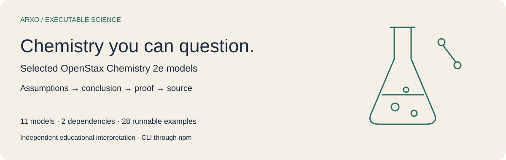
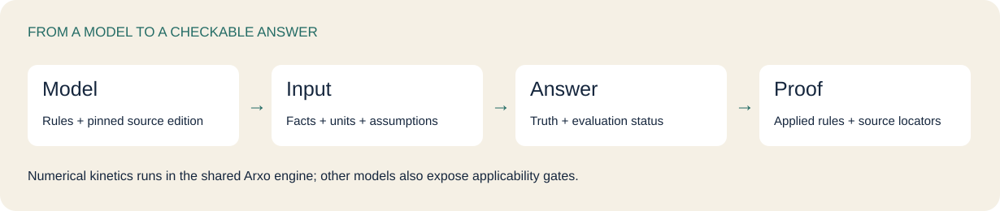
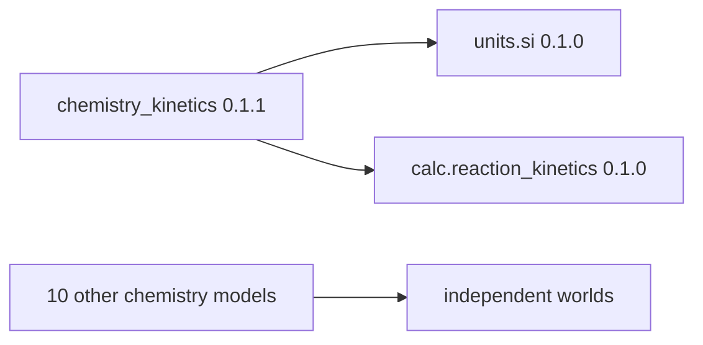
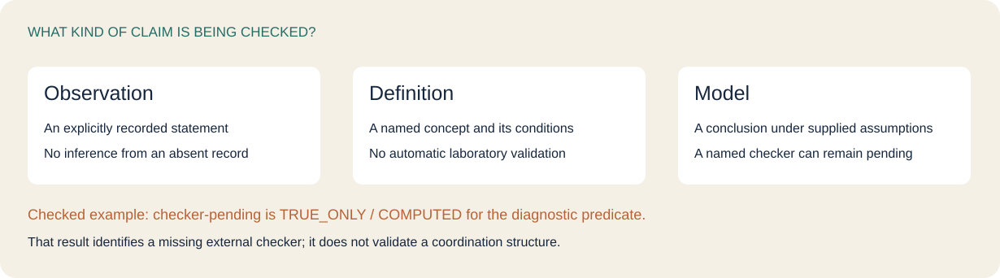
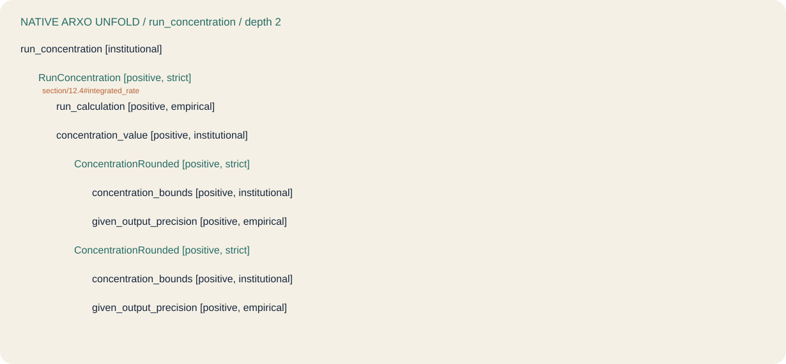

# OpenStax chemistry on Arxo

Explore selected **Chemistry 2e** claims, run numerical kinetics examples, and inspect how a conclusion depends on facts, assumptions and a pinned textbook source. This independent educational repository contains **all eleven existing Arxo chemistry models**, two dependencies and 28 runnable examples.

[Run a question](#run-a-question) · [Choose a model](#choose-a-model) · [Explore examples](#explore-examples) · [Depth and boundaries](#depth-and-boundaries) · [Reproduce](#reproduce) · [Licenses](#licenses)

## Run a question

Install the published Arxo CLI through npm with **Node.js 20+**, then obtain the models from GitHub:

```sh
npm install -g @arxo/cli@0.2.5
git clone https://github.com/arxohq/arxo-openstax-chemistry.git
cd arxo-openstax-chemistry
law eval examples/first-order-concentration
```

The example supplies first order, initial concentration **1 mol/l**, rate constant **0.1 s⁻¹**, elapsed time **10 s**, and precision **6**. It asks whether the rounded concentration is **0.367879 mol/l**. Arxo performs the calculation: the proposition is `TRUE_ONLY`, with evaluation status `COMPUTED`.

```sh
law eval examples/first-order-half-life
law eval examples/arrhenius-ratio
law inspect examples/first-order-concentration/result.json summary
```

The half-life proposition checks **6.931472 s**. The Arrhenius example checks the ratio **1.909157** for its complete recorded inputs. See the [case](examples/arrhenius-ratio/case.json) and [query](examples/arrhenius-ratio/query.json).

There is no model npm package. Models and pinned sources are delivered by this repository and its [v0.1.0 release](https://github.com/arxohq/arxo-openstax-chemistry/releases/tag/v0.1.0); npm installs the runtime.



## Choose a model

Semantics: **`law.core/0.2.11`**. These are eleven separate models, not a combined general chemistry solver. Section numbers identify selected source snapshots; they do not promise complete chapter coverage.

| Exact model | Selected scope | Model and sources |
|---|---|---|
| `openstax.chemistry_acids@0.1.0` | 14.1–14.7, 14.9 · recorded proton roles and selected titration claims | [.law files](packages/openstax.chemistry_acids) |
| `openstax.chemistry_atomic@0.1.0` | 6.4 · electronic configuration claim layers | [.law files](packages/openstax.chemistry_atomic) |
| `openstax.chemistry_bonding@0.1.0` | 7.3 · Lewis symbols, octet model and bonds | [.law files](packages/openstax.chemistry_bonding) |
| `openstax.chemistry_coordination@0.1.0` | 19.2 · coordination claim layers; external checker boundary | [.law files](packages/openstax.chemistry_coordination) |
| `openstax.chemistry_electro@0.1.0` | 17.3 · Table 17.1 excerpt: Zn, Cu, SHE and cell sign | [.law files](packages/openstax.chemistry_electro) |
| `openstax.chemistry_equilibrium@0.1.0` | 13.3–13.4 · Q/K direction and ICE conditions | [.law files](packages/openstax.chemistry_equilibrium) |
| `openstax.chemistry_gases@0.1.1` | 9.2–9.3 · ideal-gas and stoichiometry gates | [.law files](packages/openstax.chemistry_gases) |
| `openstax.chemistry_kinetics@0.1.1` | 12.3–12.5 · rate-model gates and numeric orders 0/1/2 | [.law files](packages/openstax.chemistry_kinetics) |
| `openstax.chemistry_solutions@0.1.1` | 3.3, 11.1 · dissolution, dilution and model assumptions | [.law files](packages/openstax.chemistry_solutions) |
| `openstax.chemistry_stoichiometry@0.1.0` | 3.1–3.4, 4.2–4.4 · yield basis and captured definitions | [.law files](packages/openstax.chemistry_stoichiometry) |
| `openstax.chemistry_thermo@0.1.1` | 5.3, 16.1, 16.4 · Hess and free-energy sign gates | [.law files](packages/openstax.chemistry_thermo) |

The actual import closure contains [`units.si@0.1.0`](packages/units.si) and [`calc.reaction_kinetics@0.1.0`](packages/calc.reaction_kinetics), used by kinetics. Other calculators named in source comments are conceptual boundaries; they are not imported dependencies or included implementations.



`calc.reaction_kinetics` declares no package import. Exact imports are recorded in [models.json](models.json) and each `law.lock`.

## Explore examples

Use `law eval examples/<name>`. Every directory contains a complete `case.json`, `query.json`, executable `request.json`, original expectations and a captured native result. Fixtures were compiled from the supplied `.lawtest` files by the published CLI; no chemistry semantics were recreated in Python.

| Example | Model | Captured truth | Evaluation |
|---|---|---|---|
| [water-amphiprotic](examples/water-amphiprotic) | `acids@0.1.0` | `TRUE_ONLY` | `COMPUTED` |
| [unrecorded-role](examples/unrecorded-role) | `acids@0.1.0` | `NEITHER` | `COMPUTED` |
| [disputed-role](examples/disputed-role) | `acids@0.1.0` | `NEITHER` | `COMPUTED` |
| [titration-half-equivalence](examples/titration-half-equivalence) | `acids@0.1.0` | `TRUE_ONLY` | `COMPUTED` |
| [aufbau-model](examples/aufbau-model) | `atomic@0.1.0` | `TRUE_ONLY` | `COMPUTED` |
| [layer-mismatch](examples/layer-mismatch) | `atomic@0.1.0` | `TRUE_ONLY` | `COMPUTED` |
| [lewis-symbol](examples/lewis-symbol) | `bonding@0.1.0` | `TRUE_ONLY` | `COMPUTED` |
| [octet-model](examples/octet-model) | `bonding@0.1.0` | `TRUE_ONLY` | `COMPUTED` |
| [coordination-sphere](examples/coordination-sphere) | `coordination@0.1.0` | `TRUE_ONLY` | `COMPUTED` |
| [checker-pending](examples/checker-pending) | `coordination@0.1.0` | `TRUE_ONLY` | `COMPUTED` |
| [zinc-copper-cell](examples/zinc-copper-cell) | `electro@0.1.0` | `TRUE_ONLY` | `COMPUTED` |
| [reversed-cell](examples/reversed-cell) | `electro@0.1.0` | `NEITHER` | `COMPUTED` |
| [tampered-potential](examples/tampered-potential) | `electro@0.1.0` | `NEITHER` | `COMPUTED` |
| [forward-shift](examples/forward-shift) | `equilibrium@0.1.0` | `TRUE_ONLY` | `COMPUTED` |
| [ice-without-temperature](examples/ice-without-temperature) | `equilibrium@0.1.0` | `NEITHER` | `COMPUTED` |
| [ideal-gas-licensed](examples/ideal-gas-licensed) | `gases@0.1.1` | `TRUE_ONLY` | `COMPUTED` |
| [gas-without-temperature](examples/gas-without-temperature) | `gases@0.1.1` | `NEITHER` | `COMPUTED` |
| [first-order-concentration](examples/first-order-concentration) | `kinetics@0.1.1` | `TRUE_ONLY` | `COMPUTED` |
| [first-order-half-life](examples/first-order-half-life) | `kinetics@0.1.1` | `TRUE_ONLY` | `COMPUTED` |
| [unsupported-order](examples/unsupported-order) | `kinetics@0.1.1` | `TRUE_ONLY` | `COMPUTED` |
| [arrhenius-ratio](examples/arrhenius-ratio) | `kinetics@0.1.1` | `TRUE_ONLY` | `COMPUTED` |
| [arrhenius-refused](examples/arrhenius-refused) | `kinetics@0.1.1` | `TRUE_ONLY` | `COMPUTED` |
| [dilution-conserves-amount](examples/dilution-conserves-amount) | `solutions@0.1.1` | `TRUE_ONLY` | `COMPUTED` |
| [dilution-not-declared](examples/dilution-not-declared) | `solutions@0.1.1` | `NEITHER` | `COMPUTED` |
| [yield-as-mass](examples/yield-as-mass) | `stoichiometry@0.1.0` | `TRUE_ONLY` | `COMPUTED` |
| [yield-without-basis](examples/yield-without-basis) | `stoichiometry@0.1.0` | `NEITHER` | `COMPUTED` |
| [spontaneous-forward](examples/spontaneous-forward) | `thermo@0.1.1` | `TRUE_ONLY` | `COMPUTED` |
| [free-energy-without-sign](examples/free-energy-without-sign) | `thermo@0.1.1` | `NEITHER` | `COMPUTED` |

`TRUE_ONLY` means support for the **asked predicate**. In `unsupported-order`, `arrhenius-refused`, `layer-mismatch` and `checker-pending`, that predicate reports a boundary or refusal. It does not mean that a calculation or external scientific validation succeeded. `NEITHER` means the proposition is unresolved by this model; an omitted fact is not a negative fact. Conflicting positive/negative records remain explicit: `disputed-role` has a disputed input yet its asked conclusion is `NEITHER`, not a Boolean false.



### Inspect the proof and edit a case

```sh
law inspect examples/first-order-concentration/result.json summary
law test packages/openstax.chemistry_kinetics --file tests/02-kinetic-run.lawtest
```

The full [result](examples/first-order-concentration/result.json) retains canonical result identity and `proofGraph` rule IDs. The CLI's evaluation `sourceAnchors` arrays are empty in these captures; direct propagation is not claimed as passed. Rule-to-fragment anchors and source quotations are independently resolved by the native tree below.

To change inputs, copy an example to a new directory and edit **the `case` in `request.json`**, then run `law eval` on that directory. Its sibling `case.json` and `query.json` are readable exports of the captured input, not overrides of `request.json`. Keep origins, units, precision and explicit model assumptions visible. The pinned original tests are the authoring examples.

<details>
<summary>Open the native run_concentration tree</summary>



```sh
law engine unfold registry/world/openstax.chemistry_kinetics.lawir.json   run_concentration --clir registry/package --depth 2 --lang en --json
```

This is a native `unfold`, not a case proof or a separately implemented formula. It resolves the §12.4 source fragment. [Captured tree](reports/unfold-kinetics.json).

</details>

## Depth and boundaries

Depth is measured for **all eleven chemistry packages** by the existing `boundaries.depth` implementation. The division unit is a **declared publisher section in its exact captured text snapshot**. Literal headings distinguish sections from example numbers and decimal values. Exact publication hashes and editions prevent anchors from another edition being counted.

`EXECUTABLE` means a deriving rule references a fragment in that unit. It does **not** mean every proposition, formula or exercise in that section is formalized. `SOURCE_ONLY` means a source fragment exists without deriving evidence; `—` means neither fragment nor semantic reference. Imported nodes are excluded. Identical section numbers in separate package snapshots remain separate observations.

| Package | Section snapshots | EXECUTABLE | SOURCE_ONLY | — | Scope note |
|---|---:|---:|---:|---:|---|
| `acids@0.1.0` | 8 | 3 | 5 | 0 | Selected claims; not section completeness |
| `atomic@0.1.0` | 1 | 1 | 0 | 0 | Selected claims; not section completeness |
| `bonding@0.1.0` | 1 | 1 | 0 | 0 | Selected claims; not section completeness |
| `coordination@0.1.0` | 1 | 1 | 0 | 0 | Selected claims; not section completeness |
| `electro@0.1.0` | 1 | 1 | 0 | 0 | Table 17.1 excerpt only |
| `equilibrium@0.1.0` | 2 | 2 | 0 | 0 | Selected claims; not section completeness |
| `gases@0.1.1` | 2 | 2 | 0 | 0 | Selected claims; not section completeness |
| `kinetics@0.1.1` | 3 | 2 | 1 | 0 | Selected claims; not section completeness |
| `solutions@0.1.1` | 2 | 2 | 0 | 0 | Selected claims; not section completeness |
| `stoichiometry@0.1.0` | 7 | 1 | 2 | 4 | Selected claims; not section completeness |
| `thermo@0.1.1` | 3 | 2 | 1 | 0 | Selected claims; not section completeness |

The [per-unit report](reports/formalization-depth.json) includes all source/model/declaration/implementation hashes, edition identities, deriving counts, unanchored rules and unmeasured publications. The two technical dependencies have no declared textbook division and remain `not_measured`; their exercised execution is reported separately.

```sh
python3.12 tools/measure_depth.py --check
```

This standard-library-only command reproduces all eleven measurements from the public archive without a private corpus or evaluator. [Measurement method](docs/depth.md).

Boundaries that matter:

- **Kinetics** computes supplied orders 0/1/2 and Arrhenius transfer with domain/precision checks. It does not infer order from measurements or establish that a rate model fits a real experiment.
- **Atomic, bonding and coordination** classify selected source-backed claim layers. Named external checkers are not executed by these packages; coordination exposes a pending-checker diagnostic.
- **Gases, solutions, equilibrium and thermo** mainly license supplied assumptions or infer qualitative outcomes. They are not general PV=nRT, ICE, pH or thermochemical data calculators.
- The ideal dilute solution license is an explicitly supplied model assumption. Its rule remains **unanchored** rather than attributing an unwarranted claim to the textbook.
- **Electro** pins the Zn/Cu/SHE table excerpt. It is not the whole standard-potential table or a nonstandard Nernst calculator.
- These science models contain institutional predicates for derived outputs, not deontic duties/prohibitions. No laboratory safety assessment or complete chemistry textbook formalization is claimed.
- Source extracts preserve their captured bytes. Plain-text extraction can lose superscripts, fractions and layout; consult the publisher for formatted mathematical notation.

## Reproduce

Python 3.12 is needed for maintenance checks; ordinary `law eval` use needs only the npm CLI.

```sh
python3.12 tools/check.py
python3.12 tools/measure_depth.py --check
python3.12 tools/test_section_depth.py
```

The first command checks hashes and replays all 28 examples twice. To repeat only the explicitly recorded native package suites:

```sh
python3.12 tools/check.py --packages
```

The release records **81 passed scenarios** across selected files, 13 compiled own packages, 13 linked worlds, 28 reader examples and 30 measurement regressions. Declared-but-unexecuted files are not reported as passed. The [verification report](reports/verification.json), [source pin](source-pin.json), [runtime pin](toolchain.lock.json) and [exact archive manifest](CANON-MANIFEST.json) keep these claims separate. The whole corpus is `not_checked` and `releaseVerified` is `false`.

Source revisions `0.1.1` for gases, solutions, thermo and kinetics add missing publications/source anchors; logical rule bodies and original expectations are preserved. Original `0.1.0` IR is retained under `registry/original`. Electro's missing test-file registration was repaired in its manifest; its model version remains `0.1.0`. [Provenance changes](reports/provenance-changes.json).

[Public Linux checks](https://github.com/arxohq/arxo-openstax-chemistry/actions/workflows/verify.yml) · [Rebuild selected models](docs/reproduction.md) explains native lowering/linking. CI checks this public consumer and its pinned inputs; it does not scan the full corpus.

## Licenses

Chemistry 2e by Paul Flowers, Klaus Theopold, Richard Langley and William R. Robinson; OpenStax, Rice University and content contributors. Source content, excerpts and textbook-derived adaptations retain **CC BY-NC-SA 4.0**, including embedded copies in CLIR, dependency IR and example requests. Independent Arxo code and original SVG artwork use Apache-2.0. See [NOTICE](NOTICE), [publisher attribution](https://openstax.org/books/chemistry-2e/pages/preface) and [license texts](licenses).

This project is independent; no OpenStax endorsement is implied. No publisher logos, book cover or illustrations are used as repository artwork.

Access for free at [OpenStax Chemistry 2e](https://openstax.org/books/chemistry-2e/pages/1-introduction). OpenStax/Rice University and content contributors; textbook content and adaptations: [CC BY-NC-SA 4.0](licenses/CC-BY-NC-SA-4.0.txt).
